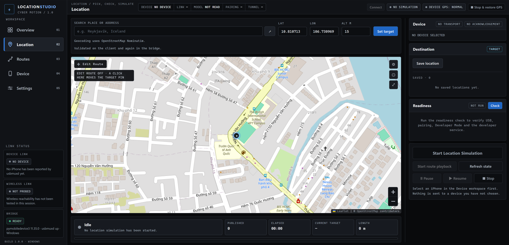
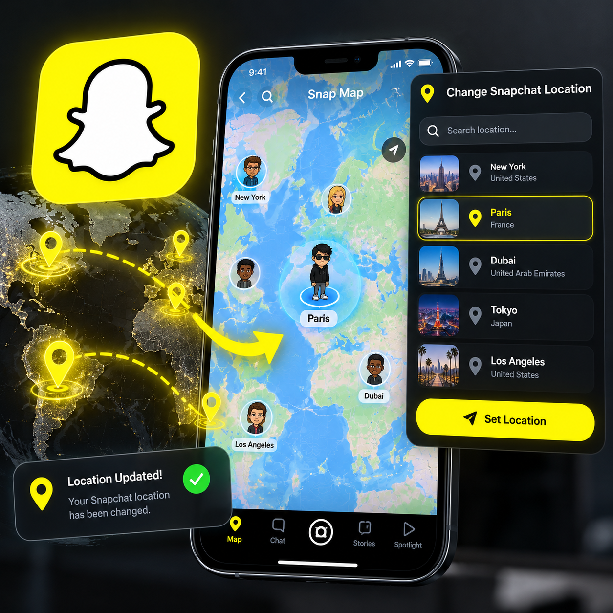

# Location Studio

Windows desktop app for **real iPhone location simulation** over a USB cable. A
wireless path is implemented too, and it is labelled exactly as honestly as the wired
one — see [Connecting an iPhone](#connecting-an-iphone).

The UI is a dark control studio — the *Cyber Motion* shell: an overview, a location
workspace, a route workspace, a device workspace and a settings workspace in one window.

It is not a mock-up and not a GPS file exporter. It drives the iPhone through the
same developer services Xcode's location simulation uses
(`com.apple.instruments.server.services.LocationSimulation` over a userspace RSD
tunnel on iOS 17+ — no administrator rights, no TUN/TAP driver, nothing installed
on the phone). Every capability is labelled **verified on hardware**, **documented
but not hardware-tested**, **unknown** or **unsupported**, and the UI never shows a
success it did not observe.

## Screenshots



*The real app: the Location workspace on the OpenStreetMap basemap (a dark Esri style is
also shipped and selectable in Settings), with the coordinate entry and search above the
map, the operation bar below it, and the Device / Destination / Readiness / primary-action
stack in the right control dock. The left rail carries the
five workspaces plus device link, wireless link and bridge state; the header keeps
device state visible from every workspace.*

| Illustrative mockup — Tinder | Illustrative mockup — Snapchat |
| --- | --- |
|  |  |

*Concept artwork showing the outcome (these two are mockups, not screenshots of
Location Studio): the app sets the iPhone's position at the system level, so apps
like Tinder and Snapchat see the simulated location. It never touches or modifies
those apps — the screenshot of the app itself is the Location workspace above.*

## Quick start (Windows)

| Requirement | Notes |
| --- | --- |
| Windows 10/11 x64 | Built and verified on Windows 11 (build 26300). |
| An iPhone with iOS 17 or newer | This is the verified path. iOS 16 and older use a legacy developer path that is implemented but was never hardware-tested here. |
| USB data cable, paired, Developer Mode enabled | Developer Mode lives in Settings → Privacy & Security. Pairing is the usual Trust prompt. |
| "Apple Devices" app (or iTunes) installed | Provides usbmuxd / Apple Mobile Device Service for USB communication. |
| Python 3.11+ with `pymobiledevice3==11.35.0` and `defusedxml==0.7.1` | Powers the device bridge. Not bundled; see below. |

**The easy way — from this folder**

1. Double-click **`Start Location Studio.cmd`** (or the *Location Studio* desktop
   shortcut). It points the app at the project's Python environment and starts the
   newest code available: the packaged build from `release\` when that build is at
   least as new as the sources, otherwise from source — because a stale packaged exe
   quietly runs code the project has already moved past. Pass `dev` or `packaged` as
   the first argument to force either path.
2. Plug in the iPhone, unlock it, tap **Trust**, then open **Device** in the app.
3. Press **Refresh** to scan, select the phone, then go to **Location** and press
   **Check** in the Readiness panel. When it reaches the developer service,
   **Start Location Simulation** becomes enabled — or build a route in **Routes** and
   press **Device route** there. The header shows what the device actually reported.

**From source**

```powershell
npm install
npm run check
npm test
npm start
```

**Packaged executables** — `npm run dist` produces `release\LocationStudio-1.0.0-win-x64.exe`
(portable) and `release\LocationStudio-Setup-1.0.0.exe` (installer). They are
**unsigned**, so Windows SmartScreen warns on first launch ("More info → Run
anyway"). Packaged builds find Python through `LOCATION_STUDIO_PYTHON` first, so the
launcher script above is the recommended way to start them.

**Python bridge environment** — install the bridge dependency once, in a virtual
environment next to the source:

```powershell
py -3.11 -m venv .venv
.\.venv\Scripts\python.exe -m pip install -r bridge\requirements.txt
```

The app finds this `.venv` automatically (or set `LOCATION_STUDIO_PYTHON` to any
interpreter that has `pymobiledevice3` installed). If no suitable interpreter
exists, the map and GPX tools still work and the Device workspace reports exactly
which interpreters were probed and what to install.

## The five workspaces

| Workspace | What it does |
| --- | --- |
| **Overview** | One screen that answers "what is true right now": device, link/transport, bridge, session, selected destination, route, wireless state, and a *what is missing* cell that names the next action. Nothing here is measured twice — it restates what the bridge reported. |
| **Location** | The main workflow. Pick a target on the map or type lat/lon, search places, then **Start Location Simulation** in the right dock. The dock is ordered by what you need: device connection → destination → readiness → the primary action → Stop. The bar under the map reports published updates, elapsed time, current target and route length. |
| **Routes** | Waypoint list (add, remove, reorder, edit coordinates), speed and update rate, GPX import/export, saved routes. A compact toolbar under the map separates **PREVIEW** (play/pause/reset + multiplier, this window only) from **IPHONE** (device route / device stop). |
| **Device** | Detect the iPhone and report *only what was observed*: usbmuxd state, pairing, Developer Mode, developer service, readiness stages, the wireless probe per transport, a device screenshot, session log — plus a capability matrix with dated evidence per row. All advanced diagnostics live here, not in the main workflow. |
| **Settings** | Basemap, units, workspace file, build and platform as reported by the main process, the six-step first-time wireless setup checklist, and what the app reads. |

Honesty rules the app enforces everywhere: a device operation is reported as
successful only after the device acknowledged it; unsupported operations answer
with `UNSUPPORTED_OPERATION` instead of pretending; a second session is refused
while one is active; the primary action stays disabled with a sentence naming
exactly what is missing; and the simulation ends — leaving real GPS restored — the
moment you press Stop, close the app or unplug the cable.

**Window sizes.** The window has a real minimum (1100 × 640) and the layout is
measured, not eyeballed, at 1280×720, 1366×768 and 1920×1080: the map keeps usable
space, the control dock sits beside it instead of over it, the header status strip
never clips mid-word, and the primary action panel is painted above the fold at all
three. Below 1420 px the dock narrows and the least load-bearing header cells drop
out — every one of them is still reported in full in the Device workspace. Two docks
are tall enough to scroll — Location at 1280×720, Routes at every size — and in both
cases the action that matters stays reachable: the Location dock pins the primary
action to its bottom edge, and Routes keeps **Device route** / **Device stop** in the
toolbar under the map rather than in the dock.
`npm run capture:ui -- --out tmp/ui` writes a PNG per workspace per size plus a
geometry table.

## Connecting an iPhone

### Over USB — the verified path

1. Install **Apple Devices** (Microsoft Store) or iTunes, so the Apple Mobile Device
   Service is running.
2. On the iPhone: **Settings → Privacy & Security → Developer Mode → on**, then let the
   phone restart. Location Studio never toggles this for you.
3. Connect a **data** cable, unlock the iPhone and tap **Trust**.
4. In the app: **Device → Refresh**, select the iPhone, then open **Location** and
   press **Check** in the Readiness panel.
5. **Start Location Simulation.** The button is only enabled once the readiness check
   has reached the developer service, and it only reports success after the device
   acknowledged the write.

### Over Wi-Fi — implemented, and labelled as unverified

Wireless is **not** automatic: pairing the phone over USB does not turn it on, and this
build has never completed a wireless simulation because no wireless-capable iPhone was
attached while it was verified. The app therefore keeps the wireless rows at
`documented`/`unknown` and refuses to call a session wireless while the cable is
attached (usbmuxd prefers the USB entry, so the result would prove nothing about Wi-Fi).

The one-time setup, mirrored in **Settings → First-time wireless setup**:

1. **Pair over USB once** — the Trust prompt creates the pairing record the Wi-Fi path
   authenticates against.
2. **Enable syncing over Wi-Fi** — with the cable still attached, turn on
   *"Sync with this iPhone over Wi-Fi"* in Apple Devices (or iTunes); on newer iOS the
   same option lives in Settings → General → iPhone Transfer.
3. **Same network, no client isolation** — phone and PC on the same subnet, and an
   access point that forwards multicast DNS. Guest networks and VPN-isolated networks
   block the discovery the wireless path depends on.
4. **Keep the Apple Mobile Device Service running** — Windows reaches a network iPhone
   through the same usbmuxd pipe that serves the cable.
5. **Developer Mode stays a manual step** — as above.
6. **iOS 17.0–17.3 needs one more thing** — those versions can only open the developer
   tunnel from a RemotePairing record, which has to be created once while the phone is
   on the cable. iOS 17.4 and newer reach it through the CoreDevice proxy without that
   bootstrap.

Then press **Discover devices** in **Device**. The probe reports three transports
separately — USB, Wi-Fi through the Apple Mobile Device Service, and RemoteServiceDiscovery
answered directly on the LAN — and each row shows only what was measured. A device that
was merely *advertised* is listed as seen, never as reachable, and gets no Connect button
unless its transport is one this build can actually operate.

**If wireless shows nothing:** check steps 2 and 3 first — the Wi-Fi sync checkbox and a
client-isolated network are the two common causes. A firewall or VPN adapter that drops
UDP 5353 blocks multicast DNS; the probe distinguishes "this PC could not ask" from "no
device answered" instead of guessing. USB keeps working regardless: the wireless path is
additive, and the app never blocks the cable.

### Troubleshooting

| Symptom | What it means | Where to look |
| --- | --- | --- |
| Double-click does nothing — no window, no error, exit code 0 | Only one instance may own the profile, so a second start creates no window. It is refused quietly by design; if the first instance is still alive but windowless, that refusal looks like a broken app. | `%APPDATA%\Location Studio\logs\location-studio.log` — the line `start refused: another instance owns this profile` is the answer. Close the older instance (Task Manager → `Location Studio` / `electron`) and start again. |
| The app starts but shows an old screen | The packaged build in `release\` predates the sources. The launcher now detects this and runs from source instead, printing both timestamps. | `npm run dist` refreshes `release\`. |
| Bridge chip reads `UNAVAILABLE` | No interpreter on this machine can import `pymobiledevice3`; the map and GPX tools still work. | The Device workspace lists every interpreter it probed and the exact `pip install` line. |
| `usbmuxd is running but reported no devices` | The service is up; the phone is not visible. Charge-only cable, untrusted prompt, or Wi-Fi sync not enabled. | Device → scan status line, and the six-step checklist in Settings. |
| Readiness stops before the developer service | Developer Mode is off, or the phone refuses developer services while locked. | Device → readiness stages; unlock the phone and press **Check** again. |
| A location call returns `DEVICE_DISCONNECTED` | The phone went away between selection and the write. | Re-scan, reselect, retry. Nothing was claimed as successful. |
| `SIMULATION_ACTIVE` | One session owns one device; a second is refused. | Press Stop first — it restores real GPS. |
| `UNSUPPORTED_OPERATION` | The protocol has no such operation (for example pausing a *fixed* location). | The capability matrix row for that operation. |
| The map is empty | Tiles need internet; the app never paints a fake basemap. | A tile-error notice replaces the map. |

## Verification status

| Result | Scope |
| --- | --- |
| **35/35** hardware acceptance checks in 30 s | Physical iPhone (iPhone 16 Pro, iOS 27.0.1 build 24A446) over USB: fixed set, route playback, pause/resume, pace accuracy, disconnection handling, refusal codes, session history, device screenshot. Recorded before the wireless work; device identifiers are omitted from this repository. |
| **60/60** smoke checks | Real Electron app at the 1280×720 minimum window: protocol, preload/IPC boundary, bridge, usbmuxd, UI honesty rules, the geometric fold promises, tile-grid coverage, basemap integrity, wireless probe wording, console hygiene. No iPhone was attached. |
| **60** JS + **171** Python unit tests | Validation, GPX, interpolation, simulation state machine, tunnel, transport pinning, wireless probe verdicts, persistence, IPC, CSP. |
| **8/8** bridge self-check | Protocol contract with no device attached. |

No physical iPhone was connected during the wireless and UI work, so nothing in it is
labelled hardware-verified. The 35/35 row above is the earlier USB record, kept because
it is the only hardware evidence this project has; the wireless rows in the capability
matrix stay `documented` or `unknown` until someone runs the acceptance tool against a
phone that is actually on the network.

Docs: [COMPATIBILITY.md](docs/COMPATIBILITY.md) (capability matrix) ·
[ACCEPTANCE.md](docs/ACCEPTANCE.md) (the recorded hardware run) ·
[TESTING.md](docs/TESTING.md) (how to run and reproduce everything) ·
[LIMITATIONS.md](docs/LIMITATIONS.md) (scope and known limits).

Generated reports and screenshots go to `docs/reports/` when you run the tools.
They contain device identifiers, so they are never published and never bundled into
the packaged app — treat them as local scratch and delete them when done.

## Building

```powershell
npm run dist        # NSIS installer + portable exe (release\)
npm run dist:dir    # unpacked build only (release\win-unpacked\)
```

On Windows, electron-builder may fail to extract its `winCodeSign` helper archive
(symlink permissions). `npm run fix:wincodesign` verifies the archive hash and
completes the extraction into the electron-builder cache; see
[LIMITATIONS.md](docs/LIMITATIONS.md).

## Project structure

```text
electron/            Main process: window, app:// protocol + CSP, IPC allowlist,
                     bridge supervisor, workspace store
renderer/            UI (ES modules, strict CSP): overview, location, routes,
                     device, settings, vendored Leaflet
bridge/              Python bridge package: device discovery, wireless transport
                     probe, RSD tunnel, DVT location simulation, GPX, route
                     scheduler, JSON-RPC server
scripts/             Tooling: asset vendoring, renderer/DOM-id contract check,
                     bridge runner, python test runner, winCodeSign fix, smoke
                     test, UI capture at three window sizes
tests/               Unit tests (js/ and python/)
tools/               Hardware acceptance runner + fixtures
docs/                Compatibility, acceptance record, testing guide, limitations
Start Location Studio.cmd   One-double-click launcher (see above)
```

## Data and external services

* Basemap tiles: Esri "Dark Gray Canvas" (dark theme) and OpenStreetMap (light
  theme) — both key-free public endpoints. Tile attribution is shown on the map.
* Geocoding: OpenStreetMap Nominatim. Respect its usage policy; this app makes
  individual search requests only.
* No account, no telemetry, no cloud backend. Everything else stays local: the
  workspace is a JSON document in the app's user-data folder.
* Startup log: `%APPDATA%\Location Studio\logs\location-studio.log`, kept as a
  capped tail of the last runs. It exists because a start that fails before a window
  exists otherwise leaves no trace at all. It names local paths, so treat it like the
  reports in `docs/reports/` — machine-local, never pasted into a public issue without
  reading it first.

## Security posture

* Only a user-selected device is ever operated on; one bridge process owns one
  device and refuses sessions for any other UDID.
* The renderer is sandboxed: a fixed JSON-RPC allowlist over the preload bridge,
  no generic `invoke`, no shell access, strict CSP (own origin + the two tile hosts
  + the geocoder only).
* No driver installs, no TUN/TAP, no administrator rights, no changes to the phone
  (no profiles, certificates or apps), no hidden persistence.
* Coordinates and GPX files are validated on both sides of the boundary before any
  device call; the UI never executes data from files or devices.
